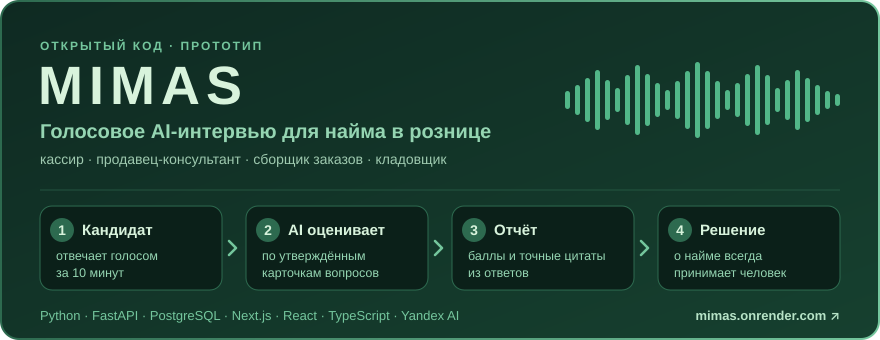
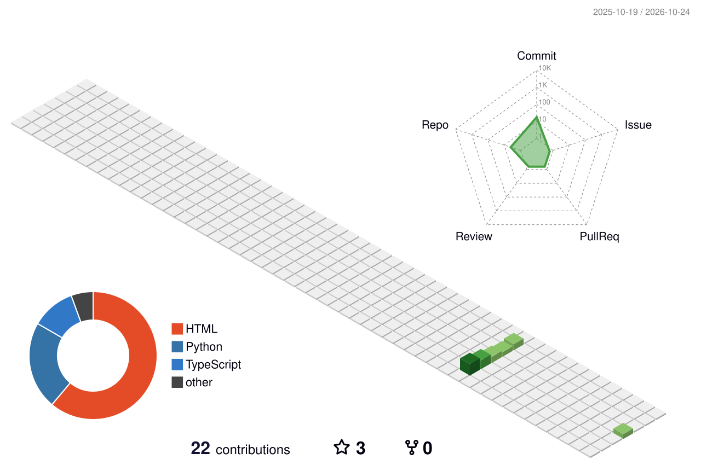

<!-- Шапка -->

  

  

  
  
  

## 🌿 Обо мне

- 🎙 Делаю **MIMAS** — голосовое AI-интервью для найма в рознице на **Python** и **Next.js** — [mimas](https://github.com/fiskarik/mimas)
- 🚁 Программирую дроны на **Python** — [sverk-drone](https://github.com/fiskarik/sverk-drone)
- 🌐 Делаю веб на **TypeScript** — [smart-choice](https://github.com/fiskarik/smart-choice), [ChessCompetition](https://github.com/fiskarik/ChessCompetition)
- 🎮 Контрибьючу в геймдев на **C#** — [Space Station 14](https://github.com/fiskarik/space-station-14), [Spellward](https://github.com/fiskarik/SW-public)
- 🔌 Собираю железо на **Arduino**
- 🌱 Сейчас изучаю: <!-- впиши своё -->

## 🚀 Главный проект — MIMAS

  

  
  
  
  

Кандидат за 10 минут отвечает голосом на вопросы о рабочих ситуациях, а работодатель получает отчёт с баллами и цитатами из ответов.

- 🎙 **Голосовое интервью** — нужен только микрофон, камера по желанию
- 📋 **Прозрачная оценка** — каждый балл подтверждён точной цитатой; акцент, грамотность и уверенность голоса не оцениваются
- 👤 **Решение принимает человек** — AI помогает с первичным отбором, но не нанимает

## 🛠 Стек

  

## 📊 Статистика

<!-- Карточки статистики, языков и проектов генерирует .github/workflows/profile-infographics.yml -->

  
  

  

## 🌳 Активность

<!-- 3D-календарь генерирует .github/workflows/profile-infographics.yml -->

  <picture>
    <source media="(prefers-color-scheme: dark)" srcset="profile-3d-contrib/profile-night-green.svg" />
    
  </picture>

## 📌 Проекты

  
  
  

## 🐍 Змейка

<!-- Змейку генерирует .github/workflows/profile-infographics.yml -->

  <picture>
    <source media="(prefers-color-scheme: dark)" srcset="assets/snake-dark.svg" />
    
  </picture>

<!-- Подвал -->

  

